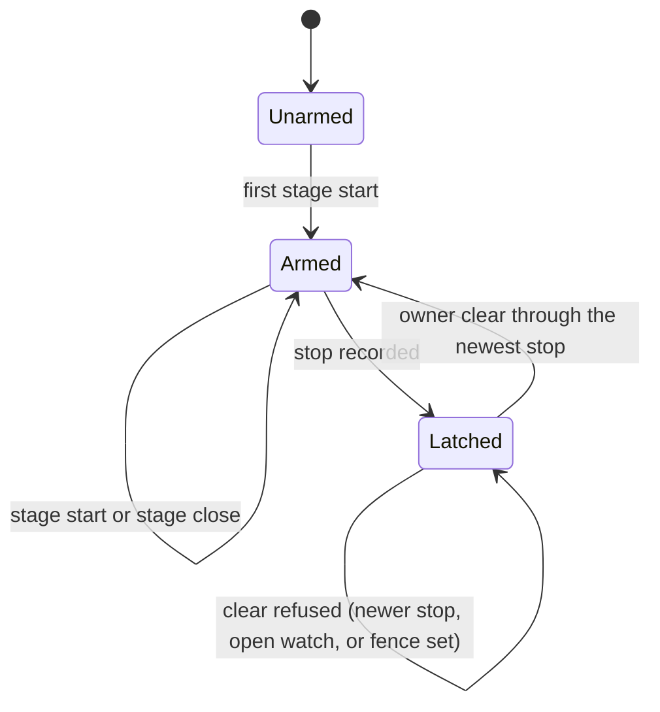
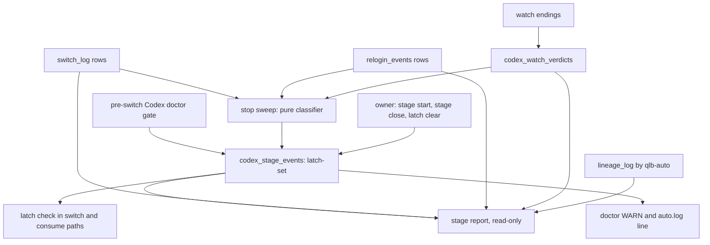
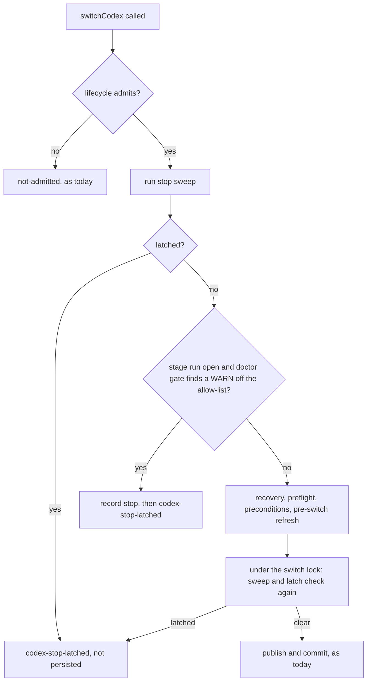

# Codex Go-Live Stop Rules - Plan

## Goal Capsule

- **Objective:** The owner takes Codex multi-account switching live one stage at a time. Each stage passes or stops on rules written down before it starts, and a stop always leaves the owner on a working native Codex login.
- **Means:** Stop rules read from tables qlb already keeps plus a recorded watch verdict per switch, a read-only stage report, and a fail-closed stop latch that refuses new Codex switches and token writes.
- **Product authority:** The owner (Sanket) decides every stage start, latch clear, rollback and flag-flip merge. `STRATEGY.md` Track 2 ("Codex multi-account switching goes live") and its Vision rules bind this work.
- **Open blockers:** None for planning. Running either stage live waits on the separate slice that wires the Codex auto-tick into `qlb-auto` (see Dependencies). Planning found two more prerequisites outside this plan: an automatic Codex decide-and-switch tick, which Stage 2 needs, and the l13 receipt writer, which Stage 1 already needs because R19 requires the receipt before Stage 1 (see Deferred to Follow-Up Work).
- **Execution profile:** 16 slices, one pull request each, all shipped dark (`CODEX_SWITCH_COMMAND_ENABLED` stays `false`). The work extends the existing repo with additive tables, new commands, tests and one Lean model. The owner merges every PR.

---

## Product Contract

### Summary

Codex switching goes live in two stages: owner-run manual switches first, then automatic switches. qlb records how each switch's watch ended, counts each stage's evidence, and reports pass, not yet, or STOP. Any stop event latches qlb into refusing new Codex switches and Codex token writes until the owner rolls back to dark and clears the latch with a reason.

### Problem Frame

Codex switching ships dark behind `CODEX_SWITCH_COMMAND_ENABLED = false` (`src/codex-switch.ts:29`). The Vision says credential custody is "validated live, in gated stages", but nothing defines what passes or fails a stage. The Anthropic cutover showed the cost of that gap. Its gates passed on receipts and exit codes. When the Gate 6 smoke failed on the Pi process title, the fix went forward over PRs #439-#443 with no rollback recorded. A blank refusal cause showed as `unknown` until #441, and native-sync WARNs exited 0. Without rules written in advance, each surprise is judged on the spot, and the default becomes to push forward.

### Key Decisions

- **Two live stages, manual then automatic.** Manual switches prove the switch path before `qlb-auto` acts without the owner watching. Governs R1, R2, R16. (session-settled: user-directed — chosen over a single live stage: automatic switching should not be the first live exercise of the switch path.)
- **Count and calendar days together.** A burst of switches in one afternoon does not show the path survives token ageing or daily use. Governs R1, R2, R4. (session-settled: user-directed — chosen over a count-only or days-only bar: each alone can be met without real exposure.)
- **Stage 2 requires a qlb-performed refresh.** Holding a token through a refresh is the custody step most likely to break a login. Governs R2. (session-settled: user-directed — chosen over leaving refresh out of the bar: a stage can otherwise pass without qlb ever refreshing an owned Codex token.)
- **All four stop events count.** Governs R7, R8, R9, R10. (session-settled: user-directed — chosen over a narrower set limited to re-logins and half-finished switches: silent unconfirmed switches and unexplained refusals were the Anthropic cutover's blind spots.)
- **Back to dark first, then fix.** A stop is answered by returning to the native login, not by patching forward on live credentials. Governs R14. (session-settled: user-directed — chosen over fix-forward: the Anthropic Gate 6 fix-forward left no recorded rollback.)
- **qlb stops new switches; the owner rolls back.** Governs R12, R14. (session-settled: user-directed — chosen over automatic rollback and over report-only: auto-rollback is itself an unproven credential write, and report-only lets automatic switching keep running after a stop.)
- **The owner clears the latch, and the stage restarts from zero.** Governs R15. (session-settled: user-directed — chosen over resuming the stage's counts: evidence gathered before a stop was gathered on the code that stopped.)
- **Derive from existing tables, adding only the state they cannot supply (Approach B).** Stages are derived from owner-recorded markers plus `switch_log`, `relogin_events` and `lineage_log`. The new recorded state is the stop latch, the per-switch watch verdict (the watch deletes its row today and leaves no trace), and the owner's stage markers and clear reasons. Governs R3, R5, R17. (session-settled: user-directed — chosen over a dedicated stage state machine and over a doctor checklist: a stage machine adds state the Vision would require proving, and a doctor checklist exits 0 on WARN.)

### Requirements

**Stages and pass bars**

- R1. Stage 1 (manual) passes when its evidence window holds at least 5 owner-run Codex switches with a confirmed watch verdict, spans at least 2 calendar days, and holds zero stop events.
  - *Changed in planning (2026-11-22):* "spans N calendar days" means N distinct local dates that each hold at least one confirmed switch, with a switch attributed to the date of its `committed_at`.
- R2. Stage 2 (automatic) passes when its evidence window holds at least 10 automatic Codex switches with a confirmed watch verdict and at least 1 qlb-performed refresh of an owned Codex token, spans at least 7 calendar days, and holds zero stop events.
  - *Changed in planning (2026-11-22):* calendar days are counted as in R1. Only a refresh qlb started on its own counts, including the pre-switch refresh of an automatic switch's target; the owner's `qlb codex refresh --force` does not.
- R3. The owner records each stage start as a dated marker. Stage 2 cannot start until the report shows Stage 1 passed.
  - *Changed in planning (2026-11-22):* a stage start is admitted only in the `cutover` lifecycle phase, and it refuses while a Codex watch is open or the latch is set. The Stage 1 result is frozen into the Stage 2 start marker.
- R4. A stage's evidence window opens at the first Codex switch after the later of its start marker and the last latch clear. Stage 1's window closes at the Stage 2 start marker, so a later Stage 2 stop does not undo Stage 1's pass.
  - *Changed in planning (2026-11-22):* a stop ends the stage run, and every restart needs a fresh stage start, so the window always opens at the first switch after the stage's latest start marker. A run is STOP when any stop is recorded at or after its start marker and before the run ends (at the next stage start, its own stage close, or the stop itself; see U2), even before its first switch; the first-switch rule governs only the count and day bars.

**Watch verdicts**

- R5. qlb records each switch's final watch verdict: confirmed, reverted (Codex wrote back its own login), unresolved, inconclusive (the login file could not be read), or late (the watch ended after the machine missed its ticks, for example while asleep).
  - *Changed in planning (2026-11-22):* the mapping from watch ending to verdict is total (KTD4). It adds four recorded values so that no ending is silent: superseded, not-admitted, wiped and unknown-live-identity. A watch that ends because the login file shows logged-out is inconclusive.
- R6. Only a confirmed verdict counts toward R1 and R2. A late verdict counts neither for nor against a stage.
  - *Changed in planning (2026-11-22):* superseded and not-admitted are neutral in the same way as late.

**Stop events**

- R7. A forced Codex re-login is a stop: an `openai-codex` `relogin_events` row of kind `identity-replaced` or `wiped`. As under the shipped S65 rule, these always count, and this work adds no way to excuse them.
  - *Changed in planning (2026-11-22):* a grant that a qlb refresh kills (a `dead` row) is also a stop. `external-login` and `healed` rows are neutral.
- R8. A half-finished switch is a stop: a `switch_log` row with outcome `failed` and detail `unknown-live-identity` or `wiped`, or a switch whose watch verdict is unresolved.
  - *Changed in planning (2026-11-22):* the wiped and unknown-live-identity verdict values are stops under this rule. An unresolved stop is recorded when the watch resolves to unresolved; until then the recovery fence already refuses switches.
- R9. An unconfirmed switch is a stop: a switch whose watch verdict is reverted or inconclusive.
- R10. An unexplained refusal or new warning is a stop: a refused Codex switch whose cause is missing or outside qlb's named refusal set, or a WARN from a Codex doctor check that is not on the allow-list recorded with the Stage 1 start marker. qlb runs the Codex doctor checks itself before admitting each switch.
  - *Changed in planning (2026-11-22):* the checks are the two Codex-only ones (`codex:slots`, `codex:first-switch`); the cross-provider `relogin:7d` check is excluded. The allow-list is keyed by check name plus result code. Only refusals that are persisted as `switch_log` rows are judged.
- R11. Every other outcome is clean and is not a stop: a refusal with a named cause, a noop, and a `failed` switch with detail `not-published` or `target-changed`.

**Response to a stop**

- R12. When a stop event is recorded during a stage, qlb latches and refuses every new Codex switch and every qlb refresh or other write of an owned Codex token, from the manual path and from `qlb-auto`.
  - *Changed in planning (2026-11-22):* narrowed. The latch refuses new switch publishes and every refresh qlb starts. It does not refuse the owner's recovery import (`qlb codex import-active`), slot adoption, or attribution mirroring and stash, because the R14 runbook needs them. The latch is global and stays armed after Stage 2 passes.
- R13. The latch tells the owner which stop event fired, with its evidence row.
  - *Changed in planning (2026-11-22):* it reaches the owner three ways: the refusal text `codex-stop-latched`, one `auto.log` line per recorded stop, and a doctor WARN (not a FAIL).
- R14. A written runbook gives the owner the exact steps that return Codex to dark with a working native login, using no command the latch refuses.
  - *Changed in planning (2026-11-22):* back to dark is a forward flag-revert PR only, never a reinstall of an older release, which would lose the latch tables.
- R15. Only the owner clears the latch, with a one-line reason recorded beside it. Restarting the stage also needs the owner's flag-flip PR merged again, and its evidence window opens per R4.
  - *Changed in planning (2026-11-22):* the clear names the last stop the owner reviewed (`--through <id>`) and refuses when a newer stop exists, a watch is open, or a recovery fence is set. A restart also needs a fresh stage start.
- R16. When the fix for a Stage 2 stop touches the Codex switch, watch or refresh code, the restart is at Stage 1.

**Stage report**

- R17. A read-only report shows each stage as pass, not yet, or STOP, with the evidence rows behind each count and each stop.
  - *Changed in planning (2026-11-22):* it is a new command, not an extension of `qlb report cutover`.
- R18. The report never writes state and never flips a flag. Each flag flip stays an ordinary owner-merged PR with the report output attached.
- R19. Before Stage 1, the report lists the entry preconditions (lifecycle phase, the `codex-first-switch` doctor check, the l13 receipt, the Codex auto-tick wired into `qlb-auto`) and whether the latch is set.
  - *Changed in planning (2026-11-22):* the list gains the automatic decide-and-switch tick and the l13 receipt writer. The report shows each missing prerequisite as a failing precondition until it exists.

**Proof**

- R20. The latch has a Lean state machine with a differential check against the shipped code.
- R21. The model proves at least: while latched, no Codex switch and no write of an owned Codex token is admitted; only an owner clear leaves the latched state; a clear resets the stage's evidence window.
  - *Changed in planning (2026-11-22):* the first property is stated as what the code can guarantee: no switch publish and no refresh request whose under-lock check began after the stop was committed. "Write of an owned Codex token" means a qlb-started refresh, per R12.

```mermaid
stateDiagram-v2
  direction TB
  [*] --> Dark
  Dark --> Stage1: owner merges flag flip, records Stage 1 marker
  Stage1 --> Stage2: report shows Stage 1 PASS, owner records Stage 2 marker
  Stage2 --> Live: report shows Stage 2 PASS
  Stage1 --> Latched: stop event (R7-R10)
  Stage2 --> Latched: stop event (R7-R10)
  Latched --> Latched: owner rolls back to dark; the latch stays set (R14)
  Latched --> Stage1: owner clears latch and re-merges flag flip; Stage 1 restarts (R15, R16)
  Latched --> Stage2: owner clears latch and re-merges flag flip; Stage 2 restarts if the fix left switch code alone (R15, R16)
```



The diagram shows the owner's path through the stages. The new runtime state is the latch (R12, R20) and the per-switch watch verdict (R5); the stages are derived from owner markers and existing tables (R3, R17).

### Key Flows

- F1. A stage runs and passes
  - **Trigger:** The owner records a stage start marker.
  - **Actors:** The owner; qlb (manual switch command or `qlb-auto`).
  - **Steps:** Switches happen; each watch records its verdict; the owner runs the report; the report shows the counts and days against R1 or R2.
  - **Outcome:** The report shows PASS, and the owner attaches it to the next flag-flip PR.
  - **Covered by:** R1, R2, R3, R4, R5, R17, R18
- F2. A stop fires and the owner recovers
  - **Trigger:** A stop event from R7-R10 is recorded.
  - **Actors:** qlb; the owner.
  - **Steps:** qlb latches and refuses new Codex switches and token writes; the owner sees which event fired; the owner follows the runbook back to dark; the owner fixes the cause in an ordinary PR; the owner re-merges the flag flip and clears the latch with a reason.
  - **Outcome:** Codex runs on the native login during the fix, and the stage, or Stage 1 under R16, restarts from zero.
  - **Covered by:** R12, R13, R14, R15, R16

### Acceptance Examples

- AE1. **Covers R1, R4.** Given Stage 1 started, when 6 confirmed manual switches all happen on one calendar day, then the report shows Stage 1 as not yet.
- AE2. **Covers R9, R12.** Given Stage 2 is running, when a switch's watch verdict is reverted, then the report shows STOP and both the next automatic switch and the next qlb refresh of the owned token are refused.
- AE3. **Covers R7.** Given Stage 1 is running, when an `openai-codex` `wiped` re-login row is recorded, then it is a stop, even if the owner started that re-login.
- AE4. **Covers R2, R4, R15.** Given Stage 2 latched on day 4, the owner rolls back, merges a fix 6 days later, re-merges the flag flip and clears the latch, and the first switch happens the next day. When the report runs 5 days after that first switch, Stage 2 shows not yet.
- AE5. **Covers R17, R18.** Given a stop event exists, when the owner runs the report, then it shows STOP with the evidence row and writes nothing.
- AE6. **Covers R10, R11.** Given Stage 1 is running, when a switch is refused with a named cause, then it is not a stop; when it is refused with no cause, it is.
- AE7. **Covers R5, R6.** Given Stage 1 is running, when the laptop sleeps through a switch's watch window, then the verdict is late and the switch neither counts toward the bar nor stops the stage.
- AE8. **Covers R4.** Given Stage 1 passed and Stage 2 started, when a Stage 2 stop is recorded, then the report still shows Stage 1 as passed.

### Scope Boundaries

- Throwaway canary accounts for live stages (open provider-terms question).
- Linux or VPS go-live stages; this work covers the macOS home only.
- Stop rules for other providers.
- Automatic rollback on a stop (rejected in Key Decisions).
- Wiring the Codex auto-tick into `qlb-auto`; it is a separate prerequisite slice for both stages.
- Considered in planning and not built: extending `qlb report cutover`; storing verdicts as `switch_log` rows; a doctor FAIL for the latch; persisting a refused row for every latch refusal; refusing switches that happen outside a stage run; rolling back by reinstalling an older release.

#### Deferred to Follow-Up Work

- Wiring `codexAutoTick` into `qlb-auto` (`AUTO_BINDINGS` is `['anthropic']`, `src/auto.ts:27`). Both stages wait on it.
- An automatic Codex decide-and-switch tick. Today the only production caller of `switchCodex` is the manual command, so Stage 2 has nothing to count.
- The l13 receipt writer. `qlb codex verify-l13` is named in `PHASE_RULES` (`src/lifecycle.ts:84`) and in the first-switch check's message (`src/checks/codex-first-switch.ts:36`), but no command writes `codex.l13VerifiedAt`.
- Flipping `CODEX_SWITCH_COMMAND_ENABLED`. Each flip is its own owner-merged PR with the report attached (R18).

### Dependencies / Assumptions

- `runDueCodexWatches` (`src/codex-switch.ts:1662`) runs only from `codexAutoTick` (`src/auto/openai-codex.ts:339`), which nothing calls, and `AUTO_BINDINGS = ['anthropic']` (`src/auto.ts:27`). A manual switch runs foreground watch ticks only at +1s, +5s and +30s, so its +120s and `until` ticks also need that consumer. Both stages therefore need the slice that wires the Codex auto-tick in before they can run live. Once wired, the tick also runs qlb's scheduled refreshes of the active Codex token, so Stage 1 is not purely manual exposure.
- Non-manual Codex switches are refused without the l13 receipt (`src/codex-switch.ts:175`), so Stage 2 assumes the receipt exists.
- An ok switch inserts a `codex_watch` row with `next_at` +120s and `until` +300s (`src/store.ts:2933-2937`). There is no verdict column, and every watch ending deletes the row; only reverts and unknown-identity failures write a `switch_log` row (`src/codex-switch.ts:1662-1680`). R5 exists because of this.
- A watch consumed more than 60 seconds after `until` is deleted with no verdict (`CODEX_WATCH_OVERDUE_MS`, `src/codex-switch.ts:1444`); R5's late verdict replaces that silent deletion.
- `switch_log.outcome` takes the values ok, noop, failed, refused and reverted-by-codex (`src/codex-switch.ts:1102`).
- The S65 rule `countsAsRelogin` (`src/relogin.ts:66`) always counts hard evidence such as `wiped` and `identity`, and nothing sets `user_denied_at` on a Codex row.

### Outstanding Questions

**Deferred to Planning**

- Extend `qlb report cutover` (it already has a `codex:L13-switch` row, `src/commands/report-cutover.ts:92`) or add a new command for the report. The lean is to extend it. **Resolved:** a new read-only command, `qlb codex stage report` (KTD9). `qlb report cutover` writes state, which R18 forbids.
- Where the watch verdict is stored: a `switch_log` completion row or a column. **Resolved:** neither. A new table `codex_watch_verdicts`, keyed by `switch_id` (KTD2).
- How a qlb-performed refresh is identified in `lineage_log`: refreshes appear with `by='qlb-cli'` and cause `post` or `stash-adopt` (`src/codex-consume.ts:460-462`), with no dedicated refresh cause. **Resolved:** automatic refreshes are tagged `by='qlb-auto'` (KTD8).
- Where stop detection runs (switch admission, the auto tick, or both), given the report itself never writes. **Resolved:** one idempotent sweep, run before every latch check and at the end of each watch tick (KTD5). The report runs the same classifier without writing.
- Which existing rollback command or commands the R14 runbook uses. **Resolved:** none is a rollback command. The runbook is a flag-revert PR, the owner's install of that build, a native `codex login` if the live login is not working, then `qlb codex import-active` (KTD12).
- How the latch reaches the owner for R13 (refusal message, doctor FAIL, `auto.log` line). **Resolved:** refusal text, one `auto.log` line per stop, and a doctor WARN (KTD10).
- Where the owner's stage markers and latch-clear reasons are stored. **Resolved:** the append-only `codex_stage_events` table (KTD1).
- What "Live" after Stage 2 passes means for the flag and for automatic switching. **Resolved:** the flag stays on, automatic switching continues, `stage close` freezes the Stage 2 result, and the latch stays armed as a permanent tripwire (KTD11).

### Sources / Research

- `src/codex-switch.ts:27-29`: the dark-launch gate and its comment ("C8 flips this only alongside its background watch consumer").
- `src/commands/switch-openai-codex.ts:147`: the gate's only consumer.
- `src/codex-add.ts:217`, `src/store.ts:2683`, `src/relogin.ts:5`, `src/relogin.ts:62-67`: re-login kinds, the Codex wipe insert, and the S65 rule.
- `src/checks/codex-first-switch.ts`: the existing first-switch doctor check (lifecycle phase plus `codex.l13VerifiedAt`).
- `src/app.ts:2441`: doctor exits 0 unless a check FAILs.
- `src/codex-auth.ts:6`: `REFRESH_AGE_MS` of 8 days, which bounds how soon a Stage 2 refresh can occur naturally.
- `docs/DESIGN-HISTORY.md` and `docs/R1B-CUTOVER-RUNBOOK.md`: the Anthropic cutover gates and the Gate 6 fix-forward.
- `docs/ideation/2026-11-22-strategy-tracks-ideation.html`: the seeding idea, with clinical-trial pre-registered stopping boundaries as the external basis.

**Product Contract preservation.** Planning changed R1, R2, R3, R4, R5, R6, R7, R8, R10, R12, R13, R14, R15, R17, R19 and R21; each carries a dated change note under its original text. R9, R11, R16, R18, R20, the Key Decisions, the flows and the acceptance examples are unchanged. Where F2 and AE4 say the owner "re-merges the flag flip and clears the latch", a fresh stage start is now also needed (R15).

---

## Planning Contract

### Key Technical Decisions

- KTD1. One append-only table, `codex_stage_events`, holds stage starts, stage closes, latch-sets and latch-clears. Each row carries the lifecycle id, the build stamp and the flag value; a stage-start row also carries the doctor allow-list and, for Stage 2, the frozen Stage 1 result. The latch is derived: it is set while any latch-set row is newer than the last clear's `through` id. The latch is global across lifecycles. (session-settled: user-approved — chosen over a mutable latch row: an append-only log keeps every stop and clear reason and makes "unseen newer stop" a plain id comparison.)
- KTD2. Verdicts live in a new table, `codex_watch_verdicts`, keyed by `switch_id`, first writer wins. (session-settled: user-approved — chosen over a `switch_log` row or column: a non-refused `switch_log` row is a "writing row" to session attribution (`src/codex-sessions.ts:352`) and to `findCodexWatchCompletion` (`src/store.ts:3057`), so a verdict row there would change switch behaviour.)
- KTD3. Both tables are created with the additive `ensure…Table` pattern used for `usage_discrepancies` (`src/store.ts:1162-1195`), with `migrationNeeded` extended to match. `V5_SCHEMA_DDL` and `SCHEMA_VERSION` are untouched. On a write connection, creating the tables on a database with no `openai-codex` rows in `switch_log` reads as empty (a fresh home). Creating them on a database that already has Codex switch history, such as a restored backup, appends an `initialize-required` row, and the latch reads as "latch state unknown", which every write path treats as latched, until the owner runs `qlb codex latch clear --initialize --reason <text>`. On a read-only connection (report, doctor) a current-version database without the tables, such as a restored backup, reads as "latch state unknown": the report says so and the doctor check warns. An unreadable or malformed row reads as latched.
- KTD4. Every deletion of a `codex_watch` row goes through one store method that writes the verdict in the same transaction. A tick that finds this switch's recovery fence set reports `fenced`, not quiet, and its row is not deleted at `until`; only fence resolution or the overdue rule ends it. The mapping is the table under High-Level Technical Design, with one test per row. (session-settled: user-approved — chosen over recording verdicts only for the five R5 values: superseded, not-admitted and logged-out endings would stay silent.)
- KTD5. Stop detection is one idempotent sweep over `switch_log`, `relogin_events` and `codex_watch_verdicts`, classified by a pure function and deduplicated by a unique index on the evidence pointer. It runs before each latch check, at the end of each watch tick, and inside the stage and clear commands. It is armed from the first stage-start row and never disarms. One incident can produce two stop rows (for example a `wiped` re-login row and its failed switch row); both are listed and one clear covers both. (session-settled: user-approved — chosen over writing a latch-set at each evidence write site: the sites are spread over four modules, and a sweep at the check catches every row committed before the check.)
- KTD6. The switch path checks the latch twice: right after lifecycle admission (`src/codex-switch.ts:1743-1744`) and again under the switch lock beside the recovery-fence check (`src/codex-switch.ts:1770-1771`). The check is a step of `switchCodex`, not part of the `admitted` dependency, because watch ticks consult `admitted` (`src/codex-switch.ts:1467`) and a latched watch must still finish and record its verdict. Latch refusals are not persisted. (session-settled: user-approved — chosen over a single check inside `admitted`: it would end open watches as not-admitted and lose their verdicts.)
- KTD7. The refresh check lives in `consumeCodexSlotLocked`, after successor adoption and before the transport call (`src/codex-consume.ts:545-564`), as a new `stop-latched` status. All three callers pass through it (`src/codex-active.ts:571`, `src/codex-switch.ts:929`, `src/commands/codex-refresh.ts:156`). Adoption, import and stash never reach the transport, so they stay open. (session-settled: user-approved — chosen over checks in each caller: one shared choke point cannot be skipped by a new caller.)
- KTD8. The consume options gain the caller's identity. The auto tick's refreshes and a non-manual switch's pre-switch refresh write lineage with `by='qlb-auto'`; everything else keeps `qlb-cli`. The precedent is the `by` union in `src/cc-resync.ts:306`. `listCodexSlotLineageChains` does not filter on `by` (`src/store.ts:3475-3476`). Stage 2 counts only rows with `by='qlb-auto'` and cause `post`, which the consume path writes only after the refresh request returns a new grant; a `stash-adopt` row, or any adoption that never reached the transport, does not count. (session-settled: user-approved — chosen over a new lineage cause: `cause` values are read by lineage repair, and `by` already has the vocabulary.)
- KTD9. `qlb codex stage report` is a separate read-only command that opens the store read-only, as `qlb status --history` does (`src/app.ts:1302`). It evaluates stages with the same pure classifier the sweep uses, so it shows a stop the sweep has not recorded yet. (session-settled: user-approved — chosen over extending `qlb report cutover`: that command writes state at `src/commands/report-cutover.ts:174-192`.)
- KTD10. The latch reaches doctor as a WARN check, `codex:stop-latch`. (session-settled: user-approved — chosen over FAIL: a FAIL would break the Anthropic cutover receipt, which requires a clean doctor.)
- KTD11. The latch stays armed after Stage 2 passes. `stage close` freezes the stage's result into its row. (session-settled: user-approved — chosen over disarming at Live: the stop events stay worth a halt after go-live.)
- KTD12. Back to dark is a forward flag-revert PR. The runbook never installs an older release. (session-settled: user-approved — chosen over reinstalling the last dark release: an older build does not know the latch tables and would ignore a set latch.)
- KTD13. R10 has two mechanical parts. An exported list names every refusal the switch path can persist, with a characterization test that reads the refusal literals out of the source, and the templated `target-freshen-<status>` causes enumerated per consume status (`src/codex-consume.ts:96-113`). The pre-switch doctor gate runs `codexSlotsCheck` and `codexFirstSwitchCheck` only (`src/diagnostics.ts:939-940`) and compares check name plus a new stable result code against the stage's allow-list. (session-settled: user-approved — chosen over running all of doctor: cross-provider checks such as `relogin:7d` would stop a Codex stage on Anthropic evidence.)
- KTD14. The latch transition and admission rules are one pure function in `src/codex-stage.ts`. The switch path, the consume path, the commands and the report all call it, and the Lean model's generated cases replay through it. That function is the tie between model and shipped code. Race behaviour, which the model does not cover, is tested with the existing `hooks.beforeFreshenLock` (`src/codex-switch.ts:1761`) and `hooks.afterObserve` (`src/codex-active.ts:517`) seams. `hooks.beforeSend` fires inside the transport wrapper, after the consume check, so a stop committed there is outside R21's guarantee by design.
- KTD17. The pure admission function also gates by stage. A non-manual switch is admitted only while a Stage 2 run is open or after a passed Stage 2 close; `switchCodex` refuses every trigger, not only the manual command, while `CODEX_SWITCH_COMMAND_ENABLED` is false. Today the flag is read only by the manual command (`src/commands/switch-openai-codex.ts:147`) and only the l13 receipt holds automatic switches off (`src/codex-switch.ts:174-176`), so without this an automatic switch could run during Stage 1 or on a reverted (dark) build. Manual switches outside a stage run stay admitted. (Plan-review correction, not owner-settled — chosen over relying on the l13 receipt alone: the receipt is a Stage 1 precondition, so it cannot keep Stage 1 manual or make a flag revert dark.)
- KTD16. `latch clear` runs recovery reconciliation and then the due-watch runner before its fence and open-watch refusals. The latch refuses switches before recovery runs (KTD6), so without this step a fence left from before the stop, with no open watch and `qlb-auto` stopped, would block the only way out of the latch. Reconciliation finishes or rolls back an earlier journal, and the watch runner only ends watches and writes verdicts; neither starts a new switch or sends a refresh request, so both stay inside narrowed R12. (Plan-review correction, not owner-settled — chosen over moving the first latch check after recovery: that would let a latched switch reach preflight and the pre-switch refresh path.)
- KTD15. `stage start` and `stage close` are admitted in `cutover` only. `latch clear` is admitted in every phase that admits a Codex switch (`cutting-over`, `cutover`, `retired`, `src/lifecycle.ts:72-95`), so a set latch can always be cleared where it can refuse.

### High-Level Technical Design

Latch state, as the Lean model and `src/codex-stage.ts` define it:



In Unarmed and Armed, switches and refreshes are admitted. In Latched, both are refused; import, adoption and stash are admitted in every state. After a clear no stage run is active until the next stage start.

Data flow from evidence to the owner:



Order of checks in a switch:



Watch ending to verdict:

| Watch ending | Code today | Verdict | Effect on a stage |
|---|---|---|---|
| Quiet at or after `until` with the target still live and no recovery fence set (for this or any switch) | `advanceCodexWatch` terminal path | confirmed | counts |
| Tick at or after `until` while any recovery fence is set | today the tick reports quiet (`src/codex-switch.ts:1501`) and the row is deleted (`:1670-1673`) | none yet: the tick reports a new `fenced` state and the row stays until the fence resolves (rows above) or goes overdue (below) | none until resolved |
| Recovery fence for this switch resolves ok at or after `until` | `src/codex-switch.ts:1477-1489` | confirmed | counts |
| Recovery fence for this switch resolves ok before `until` | `src/store.ts` `commitFenceResolution` | none yet: the watch stays open and the at-until check decides (owner decision, 2026-11-22) | — |
| Recovery fence for this switch resolves failed | `src/codex-switch.ts:1477-1489` | unresolved | stop (R8) |
| Codex wrote back its own login | revert commit, `src/store.ts:3084` | reverted | stop (R9) |
| Login file unstable or unreadable at or after `until` | `src/codex-switch.ts:1510-1512`, `:1654` | inconclusive | stop (R9) |
| Login file shows logged-out | `src/codex-switch.ts:1509` | inconclusive | stop (R9) |
| Live login wiped | `src/codex-switch.ts:1513-1517` | wiped | stop (R7, R8) |
| Live identity unknown | watch stop, `src/store.ts:3101` | unknown-live-identity | stop (R8) |
| More than 60s past `until`, no fence for this switch | `src/codex-switch.ts:1493-1496`, `:1667-1669` | a final live observation under the switch lock decides: a write-back, unreadable file, wipe or unknown identity gives reverted, inconclusive, wiped or unknown-live-identity as in the rows above; otherwise late | as that verdict |
| More than 60s past `until`, this switch's fence still set | same sites | unresolved | stop (R8) |
| A later switch replaced the watch | `src/codex-switch.ts:1508` | superseded | neutral |
| Lifecycle no longer admits the watch | `src/codex-switch.ts:1467-1468` | not-admitted | neutral |

Today a fenced tick at or after `until` deletes the watch row with no verdict. U5 changes that: the tick reports `fenced`, `runDueCodexWatches` keeps the row, and the verdict is written when the fence resolves or the row goes overdue. The recovery fence is one global row, so a fence set by any switch holds the watch open. A fenced watch is never confirmed by the quiet path; it can be confirmed only when its own switch's fence resolves ok (row above).

*Owner decision (2026-11-22):* an ok resolution of this switch's fence confirms only once the window has ended. Before `until` the watch stays open, the tick keeps observing the live login file, and the regular at-until check gives the verdict, so a Codex write-back later in the window still records reverted. Raised by the U5 code review: an early ok resolution would otherwise confirm a watch with most of its window left.

### Assumptions

- Local dates for R1 and R2 use the machine's time zone when the report runs. The classifier takes the date function as an input so tests are deterministic.
- Every `openai-codex` `dead` re-login row counts as a stop. The only writer is the consume path (`src/codex-consume.ts:244-250`), and the row does not record which caller triggered it, so this is stricter than "active or target slot": an owner `--force` that kills an idle slot's grant also stops the stage.
- A refresh triggered from `qlb gate` stays `qlb-cli` and does not count toward R2.
- `stage start` refuses while `CODEX_SWITCH_COMMAND_ENABLED` is false, which enforces the "flag flip merged again" half of R15. Tests inject the flag as the switch command already does (`src/commands/switch-openai-codex.ts:147`).
- The owner passes the allow-list explicitly at Stage 1 start (`--allow <check>:<code>`). The start refuses when a current WARN is not allowed or either check FAILs. Stage 2 inherits the list.
- R16 stays an owner judgment. The report prints the build stamp of the stopped run and of the new start so the reviewer of the flag-flip PR can see what changed.
- Manual switches outside a stage run are not refused; they count toward nothing, and stops still latch once a stage has started. Automatic switches outside an open Stage 2 run (or before a passed Stage 2 close) are refused (KTD17).

### Risks

- **A recovery step adds a stop.** A native re-login followed by `qlb codex add` writes `identity-replaced` while latched. The clear's `--through` covers it, and the runbook says to re-read the report before clearing.
- **The model proves the pure function, not the lock order.** KTD14's race tests cover the gap. The guarantee is R21's amended wording, not "never".
- **Lean is not run in CI.** The committed fixture test runs in `npm test`; the Lean build runs only through `scripts/check-lean-model.sh`, which U14's PR and the Definition of Done require.
- **A new consume status reaches three callers.** Each must map `stop-latched` to a refusal, never to a retry. U8 tests each caller.
- **Two more stop sources than the owner sees today.** The doctor gate and the refusal list can latch on something benign. Both are fixed sets with tests, and a stop costs a clear and a restart, not a login.

### Sequencing

U1, U2, U3, U4 and U16 have no dependencies; U9 and U10 wait on U16. U5 and U6 build the evidence and the latch. U7 and U8 put the latch in the write paths, and U9 adds the doctor stop source. U10 to U13 give the owner the commands, report and warning. U14 proves the model. U15 documents the result. `src/codex-switch.ts` is touched by U4, U5, U7, U8 and U9, so those run one after another. U7 and U8 wait on U11 (owner decision, 2026-11-22): the first open of a home with Codex switch history marks the latch unknown, and every write path treats unknown as latched, so no build may refuse on the latch before `qlb codex latch clear --initialize` exists to clear it.

---

## Implementation Units

### Unit Index

| Unit | Name | Requirements | Depends on |
|---|---|---|---|
| U1 | Stage-event and verdict tables | R3, R5, R15 | none |
| U2 | Pure stage and stop evaluator | R1, R2, R4, R6-R11, R21 | none |
| U3 | Named refusal list | R10, R11 | none |
| U4 | `qlb-auto` refresh lineage | R2 | none |
| U5 | Verdict at every watch ending | R5, R6 | U1 |
| U6 | Stop sweep and latch read | R7-R10, R12, R13 | U1, U2, U3 |
| U7 | Latch check in the switch path | R12, R13, R21 | U5, U6, U11 |
| U8 | Latch check in the consume path | R12, R21 | U4, U6, U7, U11 |
| U9 | Pre-switch Codex doctor gate | R10 | U1, U7, U8, U16 |
| U10 | `qlb codex stage start` and `close` | R3, R4 | U1, U2, U6, U16 |
| U11 | `qlb codex latch clear` | R15 | U6, U10 |
| U12 | `qlb codex stage report` | R17, R18, R19 | U2, U6 |
| U13 | Doctor WARN `codex:stop-latch` | R13 | U6 |
| U14 | Lean model and differential check | R20, R21 | U2 |
| U15 | Runbook and agent guides | R14, R16 | U8, U10, U11, U12, U13 |
| U16 | Stable Codex check result codes | R10 | none |

### PR1: Stage-event and verdict tables

Waits on: nothing.

### U1. Stage-event and verdict tables

- **Goal:** The store can append and read stage events and watch verdicts.
- **Requirements:** R3, R5, R15.
- **Dependencies:** none.
- **Files:** `src/store.ts`, `test/codex-stage-store.test.ts`.
- **Approach:** Add `codex_stage_events` and `codex_watch_verdicts` per KTD1 to KTD3, with a unique index on the latch-set evidence pointer and a primary key on `switch_id`. Add store methods to append each event kind, insert a verdict (ignored when one exists), and read events, verdicts and the evidence rows the sweep needs. Add read-only readers that take a read-only connection, for the report and the doctor check.
- **Execution note:** Test first. Do not touch `V5_SCHEMA_DDL` or `addColumnIfMissing`.
- **Patterns:** `ensureUsageDiscrepanciesTable` and `migrationNeeded` (`src/store.ts:1162-1195`); `readOnlySchemaRefusal` (`src/store.ts:684-692`).
- **Test scenarios:**
  - A store opened on a database without the tables creates both and reports no migration needed afterwards.
  - A second verdict for the same switch leaves the first unchanged.
  - A second latch-set for the same evidence pointer inserts nothing.
  - The read-only readers return empty lists when the tables are missing.
  - A row with an unknown event kind makes the latch reader report unreadable.
  - Opening a database that has `openai-codex` switch history but no stage tables creates them with an `initialize-required` row, and the latch reads unknown; a database with no Codex switch history reads empty.
- **Verification:** `node --test dist-test/test/codex-stage-store.test.js` passes; `npm test` passes.

### PR2: Pure stage and stop evaluator

Waits on: nothing.

This is separate from PR1 because it has no store dependency and is the function the Lean model is checked against.

### U2. Pure stage and stop evaluator

- **Goal:** One pure module decides latch state, admission, stops and stage results from rows.
- **Requirements:** R1, R2, R4, R6, R7, R8, R9, R10, R11, R21.
- **Dependencies:** none.
- **Files:** `src/codex-stage.ts`, `test/codex-stage.test.ts`.
- **Approach:** The module defines its own input row shapes. It exports the latch step and admission function (the state machine above), the stop classifier (R7 to R11 with their change notes; the named-refusal set and allow-list are inputs), and the stage evaluator (run boundaries, evidence window, counts, distinct local dates, pass, not yet or STOP). An automatic pre-switch refresh is credited to the run of the switch it preceded, even when its lineage row is earlier than that switch's commit time and so earlier than the evidence window. A run ends at the next stage start, at its own stage close, or at its first stop; the evaluator reads the frozen result for a stage whose run has ended, so a later stop never changes it. It does no I/O.
- **Execution note:** Test first, one acceptance example at a time.
- **Patterns:** the pure policy modules checked by `test/codex-poll-model.test.ts`.
- **Test scenarios:**
  - Covers AE1. Six confirmed manual switches on one local date give Stage 1 not yet.
  - Covers AE3. A `wiped` re-login row in a run is a stop.
  - Covers AE4. A Stage 2 restart whose first switch was five days ago is not yet.
  - Covers AE6. A refusal with a named cause is clean; one with a missing or unknown cause is a stop.
  - Covers AE7. A late verdict neither counts nor stops.
  - Covers AE8. A Stage 2 stop leaves the frozen Stage 1 result at pass.
  - A `dead` row is a stop; `external-login` and `healed` rows are not.
  - A stop recorded after stage start and before the first switch makes the run STOP.
  - Superseded and not-admitted verdicts are neutral; wiped and unknown-live-identity verdicts are stops.
  - The admission function admits a non-manual switch only in an open Stage 2 run or after a passed Stage 2 close, and no switch while the flag is off.
  - A `failed` switch with detail `not-published` or `target-changed`, and a noop, are clean.
  - A Stage 2 run with ten confirmed automatic switches on seven dates and no `qlb-auto` refresh is not yet.
  - A Stage 2 run whose only `qlb-auto` refresh is the first automatic switch's own pre-switch refresh, logged just before that switch commits, meets the refresh bar.
  - A clear with `through` below the newest stop, with an open watch, or with a fence set is refused.
- **Verification:** `node --test dist-test/test/codex-stage.test.js` passes.

### PR3: Named refusal list

Waits on: nothing.

This is separate because it is a characterization of existing code and changes no behaviour.

### U3. Named refusal list

- **Goal:** qlb has one exported list of every refusal cause the Codex switch path can persist.
- **Requirements:** R10, R11.
- **Dependencies:** none.
- **Files:** `src/codex-refusals.ts`, `test/codex-refusals.test.ts`.
- **Approach:** The list holds the precondition reasons (`src/codex-switch.ts:35-41`), every literal passed to the persisting refusal helper (`src/codex-switch.ts:1130-1136`), `target-freshen-<status>` for each consume status, and the causes that reach that helper through variables: the freshen holder refusal `target-held-by-session` (`:904`), every recovery-fence reason (`:920`), and every refusal member of the live-observation result union (`:214`, passed at `:1783`). The test reads the refusal literals, the consume status union, the fence reasons and the live-observation union from the source files and fails when one is missing from the list.
- **Execution note:** Characterization test. It is shown live by the mutation "remove `switch-busy` from the list".
- **Patterns:** source-reading tests in `test/wiring.test.ts`.
- **Test scenarios:**
  - Every refusal literal found in `src/codex-switch.ts` is in the list.
  - Every consume status has its `target-freshen-` name in the list.
  - `target-held-by-session`, each fence reason and each live-observation refusal is in the list.
  - The named mutation makes the test fail.
- **Verification:** `node --test dist-test/test/codex-refusals.test.js` passes.

### PR4: `qlb-auto` refresh lineage

Waits on: nothing.

This is separate because it changes what existing refreshes record and can be reviewed on its own.

### U4. `qlb-auto` refresh lineage

- **Goal:** A refresh qlb starts on its own is distinguishable in `lineage_log`.
- **Requirements:** R2.
- **Dependencies:** none.
- **Files:** `src/codex-consume.ts`, `src/codex-active.ts`, `src/codex-switch.ts`, `src/auto/openai-codex.ts`, `test/codex-refresh-lineage.test.ts`.
- **Approach:** Per KTD8. The consume options take the caller's identity, defaulting to `qlb-cli`; the lineage insert (`src/codex-consume.ts:460-462`) uses it. The auto tick and a non-manual switch's pre-switch refresh pass `qlb-auto`.
- **Execution note:** Test first. Confirm in the PR that no reader filters `lineage_log.by` on `qlb-cli`.
- **Patterns:** the `by` union at `src/cc-resync.ts:306`.
- **Test scenarios:**
  - A scheduled refresh from the auto tick writes `by='qlb-auto'`.
  - A non-manual switch's pre-switch refresh writes `by='qlb-auto'`.
  - An automatic consume that adopts a successor token without sending a refresh request writes no `post` row, so the Stage 2 refresh bar stays unmet.
  - A manual switch's pre-switch refresh and `qlb codex refresh --force` write `by='qlb-cli'`.
  - `listCodexSlotLineageChains` returns the same chains for both tags.
- **Verification:** `node --test dist-test/test/codex-refresh-lineage.test.js` passes; the existing `codex-active-refresh` and `codex-refresh` tests pass.

### PR5: Verdict at every watch ending

Waits on: PR1 merged (needs the verdict table).

This is separate because it changes the watch path, which must be reviewed against every ending on its own.

### U5. Verdict at every watch ending

- **Goal:** No `codex_watch` row is deleted without a verdict.
- **Requirements:** R5, R6.
- **Dependencies:** U1.
- **Files:** `src/store.ts`, `src/codex-switch.ts`, `test/codex-watch-verdict.test.ts`.
- **Approach:** Per KTD4 and the mapping table. One store method ends a watch and writes its verdict in one transaction; the fence-resolution, revert and stop commits (`src/store.ts:3016`, `:3084`, `:3101`) write theirs in their existing transactions. Every bare watch deletion in `codexWatchTick`, `runForegroundCodexWatches` and `runDueCodexWatches` (`src/codex-switch.ts:1466-1680`) moves to that method. `codexWatchTick` returns a new `fenced` state where it now returns quiet under a fence (`:1501`), and the deletion condition at `:1670-1673` excludes it. The overdue paths (`:1493-1496`, `:1667-1669`) make one final live observation under the switch lock before ending an unfenced watch, because `qlb-auto` sleeps a fixed 60 seconds after each pass (`src/auto.ts:26`), so an awake machine can cross the overdue line and a write-back must still record reverted. No `switch_log` row is added.
- **Execution note:** Test first, one mapping row at a time. Shown live by the mutation "restore one bare delete".
- **Patterns:** the watch helpers and no-row tests in `test/codex-switch.test.ts`.
- **Test scenarios:**
  - One test per row of the mapping table asserts the verdict value.
  - Covers AE7. A watch consumed more than 60 seconds past `until` with no fence and the target still live records late.
  - A watch consumed 90 seconds past `until`, after Codex wrote back its own login, records reverted.
  - The existing tests that assert no `switch_log` row for quiet endings still pass.
  - A second ending for the same switch leaves the first verdict.
  - A watch whose fence is still set at `until` keeps its row; when the fence later resolves failed, the verdict is unresolved, not confirmed.
  - A watch at `until` while a different switch's fence is set keeps its row and records no confirmed verdict.
  - This switch's fence resolving ok before `until` keeps the watch open with no verdict; the at-until check confirms it, and a Codex write-back inside the window after the resolution records reverted (owner decision, 2026-11-22).
  - No call to the bare watch delete remains outside the store method.
- **Verification:** `node --test dist-test/test/codex-watch-verdict.test.js` and `dist-test/test/codex-switch.test.js` pass.

### PR6: Stop sweep and latch read

Waits on: PR1, PR2 and PR3 merged (uses the tables, the classifier and the refusal list).

This is separate because it is the only writer of latch-set rows from evidence.

### U6. Stop sweep and latch read

- **Goal:** qlb can record every stop exactly once and answer "is the latch set" fail-closed.
- **Requirements:** R7, R8, R9, R10, R12, R13.
- **Dependencies:** U1, U2, U3.
- **Files:** `src/codex-stop.ts`, `test/codex-stop.test.ts`.
- **Approach:** Per KTD5. The sweep reads evidence newer than the first stage start, classifies it with U2, and appends a latch-set per new stop with its evidence pointer, build stamp and flag value. It appends one `auto.log` line per new latch-set. The latch read returns set, clear or unreadable, and callers treat unreadable as set.
- **Execution note:** Test first.
- **Patterns:** the `auto.log` append at `src/cc-resync.ts:383`; the build stamp file named at `src/release.ts:29`.
- **Test scenarios:**
  - Before any stage start, a `wiped` row records no stop.
  - After a stage start, each stop kind records one latch-set with its evidence pointer.
  - Running the sweep twice records nothing new.
  - A `wiped` re-login row and its failed switch row give two latch-set rows.
  - A malformed event row makes the latch read report unreadable.
  - One `auto.log` line is written per new latch-set and none on a repeat sweep.
- **Verification:** `node --test dist-test/test/codex-stop.test.js` passes.

### PR7: Latch check in the switch path

Waits on: PR6 merged (needs the sweep and latch read); PR5 merged (same file); PR11 merged (owner decision 2026-11-22: no build may refuse on the latch before `latch clear --initialize` exists).

This is separate because it is the first behaviour change to switch admission.

### U7. Latch check in the switch path

- **Goal:** A latched qlb refuses every new Codex switch, manual or automatic.
- **Requirements:** R12, R13, R21.
- **Dependencies:** U5 (same file, merge order), U6, U11 (the way out of the latch ships first).
- **Files:** `src/codex-switch.ts`, `src/commands/switch-openai-codex.ts`, `test/codex-switch-latch.test.ts`.
- **Approach:** Per KTD6, KTD17 and the check-order diagram. Both checks run the sweep first and return the non-persisting result with reason `codex-stop-latched`. The first check also applies the stage gate (KTD17) with reasons `codex-switch-disabled` (flag off) and `codex-auto-outside-stage-2`; both join the named refusal list. The watch runners run the sweep after their ticks. The command prints the reason with the newest stop's id and evidence pointer.
- **Execution note:** Test first. Race tests use `hooks.beforeFreshenLock`.
- **Patterns:** the under-lock fence check at `src/codex-switch.ts:1770-1771`; `safeReason` and exit codes in `src/commands/switch-openai-codex.ts:61-106`.
- **Test scenarios:**
  - Covers AE2. After a reverted verdict in a Stage 2 run, the next automatic switch returns `codex-stop-latched` and writes no `switch_log` row.
  - A manual switch while latched is refused the same way and exits non-zero.
  - A stop committed during `beforeFreshenLock` is caught by the under-lock check, and nothing is published.
  - An open watch still ticks to its verdict while latched.
  - An unreadable event table refuses the switch.
  - With no stage start recorded and the flag on, a manual switch behaves as today.
  - An automatic switch during an open Stage 1 run is refused.
  - An automatic switch after a latch clear with no stage run open is refused.
  - With the flag off, a manual or automatic switch is refused.
- **Verification:** `node --test dist-test/test/codex-switch-latch.test.js` passes; `codex-switch` and `switch-openai-codex` tests pass.

### PR8: Latch check in the consume path

Waits on: PR7 merged (reuses its refusal result and shares `src/codex-switch.ts`); PR4 merged (same files); PR11 merged (owner decision 2026-11-22, as for PR7).

This is separate because it changes every refresh caller.

### U8. Latch check in the consume path

- **Goal:** A latched qlb sends no refresh request.
- **Requirements:** R12, R21.
- **Dependencies:** U4 (same files, merge order), U6, U7, U11 (the way out of the latch ships first).
- **Files:** `src/codex-consume.ts`, `src/codex-active.ts`, `src/commands/codex-refresh.ts`, `src/codex-switch.ts`, `test/codex-consume-latch.test.ts`.
- **Approach:** Per KTD7. The check runs the sweep, then returns `stop-latched` before the transport call. The active refresh, the pre-switch refresh and the force command each map it to a refusal with reason `codex-stop-latched` and do not retry. The pre-switch refresh returns the non-persisting result.
- **Execution note:** Test first. Race test uses `hooks.afterObserve`.
- **Patterns:** the existing early returns in `consumeCodexSlotLocked` (`src/codex-consume.ts:530-560`).
- **Test scenarios:**
  - Covers AE2. After a reverted verdict, the next scheduled refresh of the active token makes no transport call.
  - `qlb codex refresh --force` while latched makes no transport call and exits non-zero.
  - A successor adoption while latched still completes.
  - A stop committed during `afterObserve`, before consume runs, is caught by the consume check, and no transport call is made.
  - A stop committed during `beforeSend` lets that one in-flight request through, and the next refresh is refused, as R21's wording allows.
  - With the store absent (pure tests), consume behaves as today.
- **Verification:** `node --test dist-test/test/codex-consume-latch.test.js` passes; `codex-active-refresh` and `codex-refresh` tests pass.

### PR9: Pre-switch Codex doctor gate

Waits on: PR7 merged (adds a step after its first check); PR8 merged (same file); PR16 merged (needs the check result codes).

This is separate because it adds a new stop source.

### U9. Pre-switch Codex doctor gate

- **Goal:** A new Codex doctor warning stops the stage before the switch it would have preceded.
- **Requirements:** R10.
- **Dependencies:** U1, U7, U8 (same file, merge order), U16.
- **Files:** `src/codex-switch.ts`, `src/commands/switch-openai-codex.ts`, `test/codex-switch-doctor-gate.test.ts`.
- **Approach:** Per KTD13, using the result codes from U16. When a stage run is open (after a stage start and before that stage's close or a stop), the switch runs both checks after the first latch check; a WARN or FAIL whose check-and-code pair is not on the latest allow-list records a latch-set with a doctor evidence pointer, and the switch is refused as latched. The doctor evidence pointer is the check, the code and the id of the latest stage-start row, so a repeat inside one run is deduplicated but the same warning in a restarted run records a new stop. The doctor-gate latch-set row also stores the check's name, code, level and message as seen at stop time, which the report prints without re-running checks. The gate runs only while a stage run is open: after a stage start and before that stage's close or a stop. With no open stage run, including after `stage close` at Live, the gate is skipped, so a new warning added by a later release cannot latch production against an old allow-list. Stop events keep latching after close (KTD11).
- **Execution note:** Test first.
- **Patterns:** the check call sites at `src/diagnostics.ts:939-940`.
- **Test scenarios:**
  - A WARN on the allow-list lets the switch proceed.
  - A WARN off the allow-list records one stop and refuses the switch.
  - The same warning on the next attempt records no second stop.
  - After the owner clears the latch and records a new stage start, the same warning on the next attempt records a new stop and latches again.
  - `relogin:7d` at WARN does not stop a Codex switch.
  - After `stage close`, a WARN off the allow-list does not stop the switch.
- **Verification:** `node --test dist-test/test/codex-switch-doctor-gate.test.js` passes; `doctor` tests pass.

### PR10: `qlb codex stage start` and `close`

Waits on: PR1, PR2 and PR6 merged (appends events, evaluates Stage 1, runs the sweep); PR16 merged (validates the allow-list against the check result codes).

This is separate because it is the first owner command that writes live state.

### U10. `qlb codex stage start` and `close`

- **Goal:** The owner can record a stage start and freeze a stage's result.
- **Requirements:** R3, R4.
- **Dependencies:** U1, U2, U6, U16.
- **Files:** `src/commands/codex-stage.ts`, `src/lifecycle.ts`, `test/wiring/commands.d/codex stage`, `docs/CLI.md`, `AGENTS.md`, `test/codex-stage-command.test.ts`.
- **Approach:** `stage start --stage <1|2>` runs the sweep and refuses, each with a named reason, when the phase is not `cutover`, the latch is set, a watch is open, the flag is off, a precondition for that stage is failing (Stage 1: the lifecycle phase, the `codex:first-switch` check, the l13 receipt and the auto-tick wiring; Stage 2: those plus the decide-and-switch tick), a current Codex check result is not allowed, or (Stage 2) the latest Stage 1 run is not a pass. It records the allow-list and, for Stage 2, the frozen Stage 1 result. `stage close` records the current stage's evaluated result. Both are new lifecycle operations admitted per KTD15, and both join the live-state list in `AGENTS.md`.
- **Execution note:** Test first. Never run against the live home.
- **Patterns:** `src/commands/lifecycle.ts:56-70`; the empty wiring marker convention in `test/wiring/commands.d/`.
- **Test scenarios:**
  - A Stage 1 start in `cutover` with the flag on appends one row with build stamp, flag value and allow-list.
  - A start outside `cutover` is refused.
  - A start with an open watch is refused.
  - A start while latched is refused.
  - A Stage 2 start without a Stage 1 pass is refused; with one, the row holds the frozen result.
  - `stage close` after a pass freezes pass; a later stop does not change the frozen row.
  - The wiring test lists the new command.
- **Verification:** `node --test dist-test/test/codex-stage-command.test.js` and `dist-test/test/wiring.test.js` pass.

### PR11: `qlb codex latch clear`

Waits on: PR10 merged (shares the lifecycle operations, CLI docs and guide edits); PR6 merged.

This is separate because the clear is the one way out of the latched state and deserves its own review.

### U11. `qlb codex latch clear`

- **Goal:** The owner, and only the owner, can clear the latch with a recorded reason.
- **Requirements:** R15.
- **Dependencies:** U6, U10.
- **Files:** `src/commands/codex-latch.ts`, `src/lifecycle.ts`, `test/wiring/commands.d/codex latch`, `docs/CLI.md`, `AGENTS.md`, `test/codex-latch-command.test.ts`.
- **Approach:** `latch clear --through <id> --reason <text>` first runs recovery reconciliation under the switch locks (`reconcileCodexRecovery`, the same step a switch runs before preflight), so a fence left behind while switches were refused can resolve. Reconciling an orphaned journal that commits ok inserts a new watch row (`src/store.ts:2933-2937`), and with `qlb-auto` stopped nothing else would consume it. So the clear next runs the due-watch runner (`runDueCodexWatches`) for watches that are due or overdue, which writes their verdicts. It then runs the sweep, which records any stop those steps produced, and refuses when the id is not the newest latch-set, a watch is still open (the refusal names the watch's `until` time, the earliest moment the runner can end a quiet watch, so the owner runs the clear again after it), a recovery fence is still set, or the reason is empty. `--initialize --reason <text>` is the only way past an `initialize-required` row; it appends an initialize row and refuses when the database has no such row. Without `--through` or `--initialize`, the command is a probe: it runs the same reconciliation, watch runner and sweep, prints the newest stop id and anything that would block a clear, and appends no clear row. On success it appends a clear row. It does not start a stage.
- **Execution note:** Test first. No agent or automatic path calls the clear.
- **Patterns:** `src/commands/lifecycle.ts:56-70`.
- **Test scenarios:**
  - A clear through the newest stop with a reason unlatches, and a switch is admitted again.
  - A clear through an older id is refused and names the newer stop.
  - A stop the sweep had not yet recorded is recorded by the clear's own sweep, and the clear is refused.
  - A clear with an open watch is refused.
  - Latch set, fence set, no open watch, `qlb-auto` stopped: the clear's reconciliation resolves the fence. A fence that resolves failed records a new stop, and a clear through that newer stop then succeeds.
  - A fence that reconciliation cannot resolve still refuses the clear and names the fence.
  - An orphaned journal that reconciliation commits ok opens a watch: the first clear is refused and names the watch's `until` (300 seconds after the commit); a clear after `until` consumes the watch through the runner, records its verdict, and succeeds when no new stop results. A clear between the 120-second tick and `until` only advances the watch and is refused again with the same time.
  - The probe form without `--through` appends no clear row.
  - On a restored database with an `initialize-required` row, a switch and a qlb refresh are refused until `latch clear --initialize` with a reason succeeds.
  - After a clear, the report shows no active stage run.
  - No source file other than the command calls the clear method.
- **Verification:** `node --test dist-test/test/codex-latch-command.test.js` and `dist-test/test/wiring.test.js` pass.

### PR12: `qlb codex stage report`

Waits on: PR2 and PR6 merged (evaluator and evidence loading); PR11 merged (same docs file).

This is separate because it is read-only and can be reviewed for exactly that property.

### U12. `qlb codex stage report`

- **Goal:** The owner can see each stage's state and the rows behind it without changing anything.
- **Requirements:** R17, R18, R19.
- **Dependencies:** U2, U6.
- **Files:** `src/commands/codex-stage-report.ts`, `test/wiring/commands.d/codex stage report`, `docs/CLI.md`, `test/codex-stage-report.test.ts`.
- **Approach:** Per KTD9. It prints, in text and `--json`: the six preconditions (the lifecycle phase is `cutover`; the `codex:first-switch` check result; a `codex.l13VerifiedAt` receipt is present; `codexAutoTick` is wired into `qlb-auto`; an automatic decide-and-switch tick exists; a writer for `codex.l13VerifiedAt` exists), the latch state with each stop, its evidence pointer and the evidence row it points to (the `switch_log`, `relogin_events` or verdict row, or the doctor check result stored with the stop), each stage's result with counts, dates and the switch ids behind them (for Stage 2 also the `lineage_log` rows counted toward the refresh bar: id, account alias, time, `by`, cause), and the build stamp and flag value of each stage start. The report goes on flag-flip PRs in a public repo, so it is a shareable projection: the whole output passes through `redactJson(report, ctx.knownSecrets())` as `qlb report cutover` does (`src/commands/report-cutover.ts:195`); each account shows as a report-local alias (`account-01`, ...), never its slot identity; evidence rows print as an allowlisted projection (table, row id, time, kind or outcome, detail code, verdict) with no raw error, steps, binding or evidence text; clear reasons print only as "recorded". This follows the migration receipt rule in `docs/CREDENTIAL-SAFETY.md`. Each precondition is marked with the stage it gates: the first four gate Stage 1 and Stage 2, the decide-and-switch tick gates Stage 2 only, and the receipt writer is informational because the receipt-present precondition already requires one. The prerequisite table is a constant; a test pins its auto-tick entry to `AUTO_BINDINGS`.
- **Execution note:** Test first, starting with the byte-for-byte database comparison.
- **Patterns:** `qlb status --history` (`src/app.ts:1301-1380`); the database snapshot helper in `test/codex-switch.test.ts`.
- **Test scenarios:**
  - Covers AE5. With a stop present, the report shows STOP with the evidence row and the database file is byte-identical afterwards.
  - Covers AE1. Six confirmed switches on one date show Stage 1 not yet.
  - Covers AE8. A Stage 2 stop still shows Stage 1 as passed.
  - A Stage 2 report lists the counted `qlb-auto` `post` lineage rows, and a `stash-adopt` or `qlb-cli` row is not counted.
  - A stop the sweep has not recorded shows as STOP, and no latch-set row is written.
  - With today's code, the last three preconditions (auto-tick wiring, decide-and-switch tick, l13 receipt writer) show as failing, and the receipt precondition fails because nothing writes it.
  - A current-version database without the new tables shows "latch state unknown", not an unset latch.
  - On a database that needs migration, the report refuses and writes nothing.
  - With seeded slot identities and an error string holding a token-shaped value, neither appears anywhere in the text or JSON output.
- **Verification:** `node --test dist-test/test/codex-stage-report.test.js` and `dist-test/test/wiring.test.js` pass.

### PR13: Doctor WARN `codex:stop-latch`

Waits on: PR6 merged (reads the latch); PR12 merged (same docs file).

This is separate because it changes doctor output for every user of doctor.

### U13. Doctor WARN `codex:stop-latch`

- **Goal:** `qlb doctor` warns while the latch is set.
- **Requirements:** R13.
- **Dependencies:** U6.
- **Files:** `src/checks/codex-stop-latch.ts`, `src/diagnostics.ts`, `test/wiring/checks.d/codex:stop-latch`, `docs/CLI.md`, `test/codex-stop-latch-check.test.ts`.
- **Approach:** Per KTD10. Read-only. WARN with the newest stop's id and evidence pointer while latched, unreadable, or unknown because the tables are missing; not applicable before any stage start; otherwise INFO. It does not run the sweep.
- **Execution note:** Test first.
- **Patterns:** `src/checks/codex-first-switch.ts`; the call list at `src/diagnostics.ts:939-944`.
- **Test scenarios:**
  - Latched gives WARN naming the stop; doctor's exit code stays 0.
  - Cleared gives INFO.
  - A current-version database without the new tables gives WARN "latch state unknown".
  - No stage start gives not applicable.
  - The wiring test lists the new check.
- **Verification:** `node --test dist-test/test/codex-stop-latch-check.test.js` and `dist-test/test/wiring.test.js` pass.

### PR14: Lean model and differential check

Waits on: PR2 merged (the function the cases replay through).

This is separate because it adds a Lean project and changes the shared check script.

### U14. Lean model and differential check

- **Goal:** The latch rules are proved in Lean and tied to the shipped function.
- **Requirements:** R20, R21.
- **Dependencies:** U2.
- **Files:** `proofs/codex-stop-latch/`, `scripts/check-lean-model.sh`, `test/fixtures/codex-stop-latch-model-cases.json`, `test/codex-stop-latch-model.test.ts`.
- **Approach:** The model mirrors the latch state diagram. It proves: while latched, switch and refresh are not admitted; only a clear leaves latched; a clear is refused with a newer stop, an open watch or a set fence; after a clear no stage run is active; import and adoption are admitted in every state. A generator emits cases; the fixture is committed; the test replays each case through U2's latch step. The script takes a model name, runs every model when given none, and derives the fixture and test names from the model name.
- **Execution note:** Model first, then the fixture test. No placeholder proofs.
- **Patterns:** `proofs/codex-poll/` and `test/codex-poll-model.test.ts`.
- **Test scenarios:**
  - Every generated case gives the same next state and admission result in the shipped function.
  - Shown live by the mutation "admit a refresh while latched" in U2.
  - `scripts/check-lean-model.sh codex-poll` still passes.
- **Verification:** `scripts/check-lean-model.sh codex-stop-latch` exits 0; `node --test dist-test/test/codex-stop-latch-model.test.js` passes.

### PR15: Runbook and agent guides

Waits on: PR8, PR10, PR11, PR12 and PR13 merged (documents their behaviour and tests it end to end).

This is last because it describes the finished commands.

### U15. Runbook and agent guides

- **Goal:** The owner has exact back-to-dark steps, and the agent guides match the code.
- **Requirements:** R14, R16.
- **Dependencies:** U8, U10, U11, U12, U13.
- **Files:** `docs/CODEX-GO-LIVE-RUNBOOK.md`, `docs/ARCHITECTURE.md`, `AGENTS.md`, `docs/slices.json`, `test/codex-go-live-runbook.test.ts`.
- **Approach:** The runbook covers starting a stage, reading the report, and answering a stop per KTD12: merge the flag-revert PR, install that build, log in natively if the live login is not working, run `qlb codex import-active`, run `qlb codex latch clear` once without `--through` to see whether a fence or a newer stop blocks it (a refusal writes nothing beyond what its own reconciliation and sweep record), fix in an ordinary PR, re-read the report, clear through the newest stop, re-merge the flag flip, start the stage. It states the R16 rule and never names an older-release install. It has a separate path for the retired lifecycle phase, where the owner's import of the live login is not admitted (`src/lifecycle.ts:89-92`): after a native `codex login`, the owner re-adds the slot with `qlb codex add`, which retired admits, then clears the latch. It also covers the one-time `latch clear --initialize` after installing this feature onto a home with Codex switch history. The test runs each qlb command the runbook names against a latched test home. `AGENTS.md` is reviewed against the code: the module map gains the new modules and the Codex switch, consume and auto-tick files it omits today. `docs/slices.json` gains entries only if the slice-graph test requires them.
- **Execution note:** Write the latched-commands test first.
- **Patterns:** `docs/R1B-CUTOVER-RUNBOOK.md`.
- **Test scenarios:**
  - While latched, `qlb codex import-active` succeeds in a test home in the `cutover` phase.
  - In a test home in the `retired` phase, every command the retired path names is admitted and succeeds while latched.
  - While latched, `qlb codex add` and a successor adoption succeed.
  - While latched, the report leaves the database byte-identical, and doctor writes only its usual `health_log` row (no stage-event or verdict rows).
  - Every `qlb` command named in the runbook is a registered command.
- **Verification:** `node --test dist-test/test/codex-go-live-runbook.test.js` passes; `npm test` passes.

### PR16: Stable Codex check result codes

Waits on: nothing (first wave). Numbered last to keep unit IDs stable; it was split out of U9 in plan review.

This is separate because both the stage start (U10) and the pre-switch gate (U9) key on these codes, and one shared slice keeps them from inventing two schemes.

### U16. Stable Codex check result codes

- **Goal:** Each outcome of `codex:slots` and `codex:first-switch` carries a stable code the allow-list can name.
- **Requirements:** R10.
- **Dependencies:** none.
- **Files:** `src/checks/claude-slots.ts` (home of the `HealthCheck` type; type-only change), `src/checks/_check.ts`, `src/checks/codex-slots.ts`, `src/checks/codex-first-switch.ts`, `test/codex-check-codes.test.ts`.
- **Approach:** Add an optional `code` beside the check's level and message, and set one code per distinct WARN or FAIL outcome of the two checks. The `guardCheck` catch-all FAIL carries the code `check-threw`. Other checks are unchanged.
- **Execution note:** Characterization first: pin today's level and message for each outcome, then add codes. Shown live by the mutation "give two outcomes the same code".
- **Patterns:** `src/checks/codex-first-switch.ts`.
- **Test scenarios:**
  - Each WARN and FAIL outcome of the two checks has a distinct code.
  - Doctor text and JSON output are unchanged apart from the code field.
- **Verification:** `node --test dist-test/test/codex-check-codes.test.js` passes; `doctor` tests pass.

---

## Verification Contract

- **Environment:** every command runs with `QLB_TEST_MODE=1` and a temporary `QLB_HOME`. No slice runs a live-state command, `qlb gate` or `qlb token`.
- **Before each PR:** `npm run build`, `npm run typecheck:pi` and `npm test` all pass, and the PR says they were run.
- **Single-file run:** `export QLB_TEST_MODE=1 QLB_HOME="$(mktemp -d)"`, then `npm run build && node scripts/clean-registry-output.cjs dist-test/src && npx tsc -p tsconfig.test.json`, then `node --test dist-test/test/<name>.test.js`. Each slice's Check names its file; the expected result is exit 0 with 0 failures.
- **Lean:** `scripts/check-lean-model.sh` with no argument builds every model, rejects placeholder proofs, and fails when a committed fixture differs from the generator output.
- **TDD evidence:** each behaviour PR shows its failing test first. U3, U5, U14 and U16 name the mutation that proves their characterization test is live.
- **Read-only proof:** U12 compares the database file byte for byte before and after a report run; U13 does the same around a direct call of the stop-latch check function, because `qlb doctor` itself appends a `health_log` row (`src/app.ts:2438`).
- **Requirement coverage:** AE1, AE3, AE4, AE6, AE7, AE8 in U2; AE2 in U7 and U8; AE5 in U12; AE7 again in U5.
- **CI:** the pinned `qlb-pi-*` and `keychain-client` tests stay at `skipped 0`.

---

## Definition of Done

- All 16 PRs are merged by the owner, each one slice, each with Conventional Commit messages and the three pre-PR commands reported.
- `CODEX_SWITCH_COMMAND_ENABLED` is still `false`.
- Every watch ending in the mapping table has a passing test, and no bare watch deletion remains.
- A latched test home refuses a manual switch, an automatic switch, a scheduled refresh and a forced refresh, and admits import, adoption, the report and doctor.
- `qlb codex stage report` leaves the database byte-identical and, on a test home seeded in the `cutover` phase, shows these preconditions as failing: the l13 receipt, the auto-tick wiring, the decide-and-switch tick and the receipt writer (and the `codex:first-switch` check, which needs the receipt).
- `scripts/check-lean-model.sh` passes for both models with no placeholder proofs.
- `docs/CODEX-GO-LIVE-RUNBOOK.md`, `docs/CLI.md`, `docs/ARCHITECTURE.md` and `AGENTS.md` describe the shipped behaviour, and the new write commands are on the live-state list.
- Cleanup: no test writes outside its temporary home, no temporary fixture or scratch file is committed, no `dist/` or `dist-test/` output is committed, and the unused bare watch-delete path is removed or made private to the store.
- Every Outcome cell in the micro-slice table is filled.

---

## Micro-slice contract

| ID | name | Start state | Depends on | Touches | Change | Check | Outcome |
|---|---|---|---|---|---|---|---|
| U1 | Stage-event and verdict tables | main | — | `src/store.ts`, `test/codex-stage-store.test.ts`, `db:codex_stage_events`, `db:codex_watch_verdicts` | Add both tables additively with append, insert and read methods | `node --test dist-test/test/codex-stage-store.test.js` exits 0, 0 failures | — |
| U2 | Pure stage and stop evaluator | main | — | `src/codex-stage.ts`, `test/codex-stage.test.ts` | Add the pure latch step, stop classifier and stage evaluator | `node --test dist-test/test/codex-stage.test.js` exits 0, 0 failures | — |
| U3 | Named refusal list | main | — | `src/codex-refusals.ts`, `test/codex-refusals.test.ts` | Export the named refusal set with a source-reading characterization test | `node --test dist-test/test/codex-refusals.test.js` exits 0; fails under the named mutation | — |
| U4 | `qlb-auto` refresh lineage | main | — | `src/codex-consume.ts`, `src/codex-active.ts`, `src/codex-switch.ts`, `src/auto/openai-codex.ts`, `test/codex-refresh-lineage.test.ts` | Tag automatic refreshes `by='qlb-auto'` in `lineage_log` | `node --test dist-test/test/codex-refresh-lineage.test.js` exits 0, 0 failures | — |
| U5 | Verdict at every watch ending | U1 merged | U1 | `src/store.ts`, `src/codex-switch.ts`, `test/codex-watch-verdict.test.ts`, `db:codex_watch_verdicts`, `db:codex_watch` | Write a verdict in the same transaction as every watch ending | `node --test dist-test/test/codex-watch-verdict.test.js` exits 0, one passing test per mapping row | — |
| U6 | Stop sweep and latch read | U1, U2, U3 merged | U1, U2, U3 | `src/codex-stop.ts`, `test/codex-stop.test.ts`, `db:codex_stage_events`, `file:auto.log` | Add the idempotent stop sweep and the fail-closed latch read | `node --test dist-test/test/codex-stop.test.js` exits 0, 0 failures | — |
| U7 | Latch check in the switch path | U5, U6, U11 merged | U5, U6, U11 | `src/codex-switch.ts`, `src/commands/switch-openai-codex.ts`, `test/codex-switch-latch.test.ts` | Refuse a switch after admission and again under lock while latched | `node --test dist-test/test/codex-switch-latch.test.js` exits 0, 0 failures | — |
| U8 | Latch check in the consume path | U4, U6, U7, U11 merged | U4, U6, U7, U11 | `src/codex-consume.ts`, `src/codex-active.ts`, `src/commands/codex-refresh.ts`, `src/codex-switch.ts`, `test/codex-consume-latch.test.ts` | Return `stop-latched` before the refresh transport and map it in all three callers | `node --test dist-test/test/codex-consume-latch.test.js` exits 0, 0 failures | — |
| U9 | Pre-switch Codex doctor gate | U8, U16 merged | U1, U7, U8, U16 | `src/codex-switch.ts`, `src/commands/switch-openai-codex.ts`, `test/codex-switch-doctor-gate.test.ts`, `db:codex_stage_events` | Run the two Codex checks before a switch and record a stop for a warning off the allow-list | `node --test dist-test/test/codex-switch-doctor-gate.test.js` exits 0, 0 failures | — |
| U10 | `qlb codex stage start` and `close` | U1, U2, U6, U16 merged | U1, U2, U6, U16 | `src/commands/codex-stage.ts`, `src/lifecycle.ts`, `test/wiring/commands.d`, `docs/CLI.md`, `AGENTS.md`, `test/codex-stage-command.test.ts`, `db:codex_stage_events` | Add the owner commands that record a stage start and freeze a stage result | `node --test dist-test/test/codex-stage-command.test.js dist-test/test/wiring.test.js` exits 0, 0 failures | — |
| U11 | `qlb codex latch clear` | U10 merged | U6, U10 | `src/commands/codex-latch.ts`, `src/lifecycle.ts`, `test/wiring/commands.d`, `docs/CLI.md`, `AGENTS.md`, `test/codex-latch-command.test.ts`, `db:codex_stage_events` | Add the owner clear with `--through` and `--reason` and its refusals | `node --test dist-test/test/codex-latch-command.test.js dist-test/test/wiring.test.js` exits 0, 0 failures | — |
| U12 | `qlb codex stage report` | U11 merged | U2, U6 | `src/commands/codex-stage-report.ts`, `test/wiring/commands.d`, `docs/CLI.md`, `test/codex-stage-report.test.ts` | Add the read-only stage report with preconditions and evidence rows | `node --test dist-test/test/codex-stage-report.test.js dist-test/test/wiring.test.js` exits 0; database byte-identical | — |
| U13 | Doctor WARN `codex:stop-latch` | U12 merged | U6 | `src/checks/codex-stop-latch.ts`, `src/diagnostics.ts`, `test/wiring/checks.d`, `docs/CLI.md`, `test/codex-stop-latch-check.test.ts` | Add a read-only doctor check that warns while latched | `node --test dist-test/test/codex-stop-latch-check.test.js dist-test/test/wiring.test.js` exits 0, 0 failures | — |
| U14 | Lean model and differential check | U2 merged | U2 | `proofs/codex-stop-latch`, `scripts/check-lean-model.sh`, `test/fixtures/codex-stop-latch-model-cases.json`, `test/codex-stop-latch-model.test.ts` | Add the latch model, generalize the check script, commit the fixture and its replay test | `scripts/check-lean-model.sh` exits 0 for `codex-poll` and `codex-stop-latch` | — |
| U15 | Runbook and agent guides | U8, U10, U11, U12, U13 merged | U8, U10, U11, U12, U13 | `docs/CODEX-GO-LIVE-RUNBOOK.md`, `docs/ARCHITECTURE.md`, `AGENTS.md`, `docs/slices.json`, `test/codex-go-live-runbook.test.ts` | Write the back-to-dark runbook, bring the guides in line with the code, test the runbook's commands while latched | `node --test dist-test/test/codex-go-live-runbook.test.js` exits 0, 0 failures | — |
| U16 | Stable Codex check result codes | main | — | `src/checks/claude-slots.ts`, `src/checks/_check.ts`, `src/checks/codex-slots.ts`, `src/checks/codex-first-switch.ts`, `test/codex-check-codes.test.ts` | Give `codex:slots` and `codex:first-switch` a stable result code per outcome | `node --test dist-test/test/codex-check-codes.test.js` exits 0, 0 failures | — |

Each Check assumes the single-file build steps in the Verification Contract have run.

---

## Execution waves

Computed by `node ~/.claude/scripts/slice-waves.mjs` over the micro-slice contract above (exit 0). Each wave's slices can run as parallel workers in their own worktrees; a slice still opens only after its Depends-on PRs merge.

```text
Wave 1 (parallel): U1, U2, U3, U4, U16
Wave 2 (parallel): U5 (after U1), U6 (after U1, U2, U3), U14 (after U2)
Wave 3: U10 (after U1, U2, U6, U16)
Wave 4: U11 (after U6, U10)
Wave 5 (parallel): U7 (after U5, U6, U11), U12 (after U2, U6) — waited: conflicts with U10 on test/wiring/commands.d
Wave 6 (parallel): U8 (after U4, U6, U7, U11), U13 (after U6) — waited: conflicts with U10 on docs/CLI.md
Wave 7 (parallel): U9 (after U1, U7, U8, U16), U15 (after U8, U10, U11, U12, U13)
Max parallel: 5 · waves: 7
```

---

## Plan review record

Gate (owner rule, 2026-11-19): at least 2 validation and 2 adversarial reviews across at least 2 model families other than the author's (Claude), re-reviewed until no HIGH or BLOCKER finding remains.

Author: Fable (Claude), native subagent, read-only.

| Round | Reviewer | Lens | Verdict | Findings | Disposition |
|---|---|---|---|---|---|
| 1 | GPT-6.1 Terra (codex CLI, high; served model confirmed, independence verified) | Adversarial | Findings | P1: a `qlb-auto` lineage row alone does not prove a refresh request ran | Fixed: Stage 2 counts only `qlb-auto` rows with cause `post` (KTD8, U4 test) |
| 1 | GPT-6.1 Terra (codex CLI, high; served model confirmed, independence verified) | Whole-document validation | Findings | P1: a repeated doctor warning cannot re-latch after a clear. P2: the report printed stop pointers, not evidence rows | Fixed: the doctor evidence pointer includes the latest stage-start or clear id (U9); the report prints the evidence row (U12) |
| 1 | Grok 4.7 (grok CLI via acpx, xhigh) | Adversarial, whole-document | Not run | Provider "Internal error", twice | — |
| 1 | Grok 4.7 (grok CLI headless, xhigh) | Validation, adversarial | Not run | HTTP 402: Grok Build usage balance exhausted | — |

| 1 | K3 (Kimi, Pi pane in tmux, high) | Adversarial | FAIL | HIGH: a watch fenced at `until` is deleted with no verdict, so the plan's "keeps its row" claim was false (`src/codex-switch.ts:1501`, `:1670-1673`). HIGH: latch set, fence set and no open watch blocks the owner's only exit. MEDIUM: the doctor gate stayed armed after `stage close`. LOW: a missing additive table read as an unset latch on read-only paths | Fixed: the `fenced` tick state keeps the row (KTD4, U5); `latch clear` reconciles recovery first (KTD16, U11, runbook); the gate runs only in an open stage run (U9); read-only readers report "latch state unknown" (KTD3, U12, U13) |
| 1 | GLM 5.3 (Zhipu, Pi pane in tmux, high) | Validation | PASS_WITH_FINDINGS | HIGH: U10 needs the check result codes but shipped two waves before U9 added them. LOW: the precondition list was double-counted and inconsistent | Fixed: new slice U16 for the result codes, with U9 and U10 depending on it; the report names six preconditions once (U12, DoD) |

Not available: the Gemini route (no Antigravity CLI installed). The Pi pane route ran from a tmux session the owner opened for this review.

| 2 | K3 (Kimi, Pi pane in tmux, high) | Adversarial re-review | FAIL | HIGH: the clear's reconciliation can commit an orphaned journal, which opens a watch that nothing consumes, so the clear stays refused (`src/store.ts:2933-2937`). LOW: the runbook's probe call without `--through` was not specified | Fixed: the clear runs the due-watch runner after reconciliation and names when an open watch becomes due; the probe form is specified (KTD16, U11) |
| 2 | GLM 5.3 (Zhipu, Pi pane in tmux, high) | Validation re-review | PASS_WITH_FINDINGS | LOW: the `HealthCheck` type lives in `src/checks/claude-slots.ts`, not `_check.ts`. LOW: the DoD counted three failing preconditions, but a fresh home shows four | Fixed: U16 Files and Touches, the `guardCheck` code, the DoD wording |

| 3 | K3 (Kimi, Pi pane in tmux, high) | Adversarial re-review | PASS_WITH_FINDINGS | MEDIUM: a quiet watch ends only at or after `until`, not at its 120-second tick, so the clear's refusal named a time too early | Fixed: the refusal names `until`, and the U11 scenario expects the intermediate refusal |

**Convergence state: CONVERGED (round 3 of 3).** Three non-Claude families (GPT, Kimi, GLM) ran 3 adversarial and 3 validation reviews in all (GPT 1 + 1 in round 1; K3 adversarial in rounds 1 to 3; GLM validation in rounds 1 and 2). No BLOCKER or HIGH finding is open. Every finding from every round is fixed in the plan. No residual findings go to the owner.

**Owner decision after convergence (2026-11-22).** The PR1 code review (adversarial lens) found that PR8 could ship before PR11: the first open of a home with Codex switch history marks the latch unknown, PR8 refuses refreshes while unknown, and only PR11's `latch clear --initialize` clears it. The owner ruled that PR7 and PR8 wait on PR11. This adds dependency edges only (Unit Index, PR7 and PR8 headers, U7 and U8 Dependencies, the contract, Sequencing, Execution waves); no unit's content changed, and the waves were recomputed with `slice-waves.mjs` (exit 0, still 7 waves).
